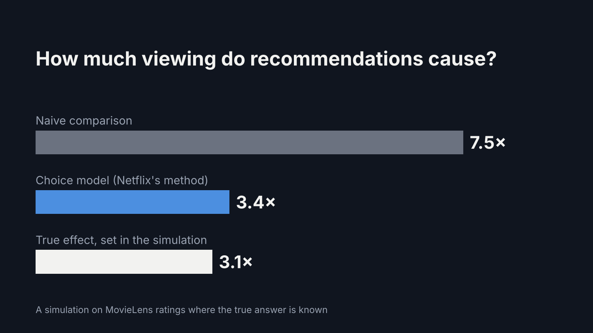
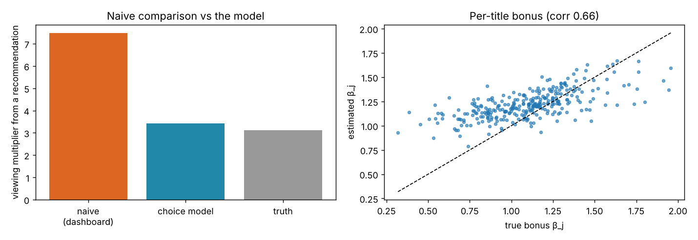
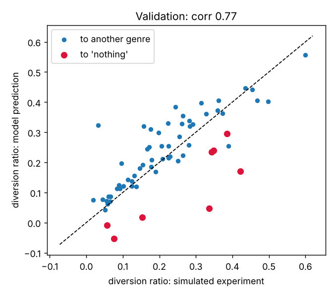
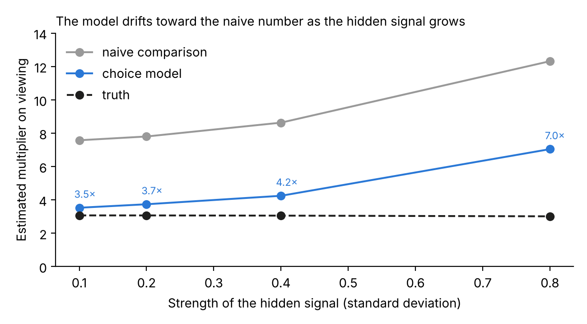

# I tested Netflix's method for measuring recommendations in a simulation where I know the answer

## In my simulation, a naive comparison said recommendations multiply viewing by 7.5×. The truth was 3.1×. My rebuild of Netflix's model found 3.4×, until I hid one signal from it.

Anyone who has worked on a recommender has been asked some version of this question: how much of our viewing comes from recommendations? I've spent eight years answering the marketing version of it, usually about media spend, and the answer is always harder to get than a dashboard makes it look. Netflix's researchers recently published a careful method for it. I rebuilt the method in a simulation where I know the true effect. It removed most of a large bias. It also showed me two things to watch: the validation test can't tell a good model from a crude one unless the experiment is big, and one hidden signal is enough to push the estimate back toward the naive number.

All the viewing below is simulated. Nothing here says anything about Netflix's real numbers.

## What Netflix did

The naive answer is easy to build. Take every time a title was recommended and every time it wasn't, and compare how often people watched it. The trouble is that the recommender shows people what they were already likely to watch, so the comparison mixes "watched because it was shown" with "shown because you'd watch it."

Netflix's approach, by Zielnicki, Aridor, Bibaut, Tran, Chou and Kallus, is to model the choice itself. Every day each member picks one title or watches nothing, and a title's appeal is the member's taste plus an extra push when the title is recommended that day. They treat what the recommender shows as random once you account for what the model can see about the member and the title. They then checked the model against a real A/B test that shifted recommendations toward one category of titles at a time, with eight arms of about a million members each for five weeks, and it predicted where viewing moved with a correlation of 0.86. They report that showing a title to an average member roughly triples the chance it gets watched.

## How I set it up

I started from about 890,000 real MovieLens ratings, which gave me realistic tastes, popularity, genres and a viewing history for each member. On top of that I simulated 40 days of recommendations and viewing for 4,000 members, with every assumption written down in the notebook. One assumption is the true push from a recommendation, which I set so that it roughly triples the odds of watching, in line with Netflix's figure.

This is the friendliest possible test. My simulated members choose the way the model assumes they do, so if the method fails here, it would likely fail on real data too. If it works here, that is necessary but not sufficient.

## What happened

The naive comparison said recommended titles were watched 7.5× as often. The true effect was 3.1×. The choice model estimated 3.4×. I reran the whole simulation in two more random worlds and got the same picture each time: the naive number at 7.4× to 7.6×, the truth at 3.1× to 3.2×, and the model at 3.4× to 3.7×. So the method removes most of the bias and still overshoots by 10% to 16%.

*Figure 1. Left: the naive comparison, the choice model and the truth. Right: the model's per-title push against the true one.*

The overshoot took me the longest to understand. I first suspected the estimator, so I gave it each member's true taste instead of the one rebuilt from history. Fit to convergence, it then landed within about 1% of the true push. So the problem is the part of the model that rebuilds taste from viewing history. Whatever it misses, the recommender still knows, and that leftover knowledge leaks into the estimate as extra push. A better history encoder, more training and more members all shrank the gap. With 16,000 members instead of 4,000 the overshoot fell to 4%.

## The validation test needs a big experiment

Netflix's check is the nudge experiment. Their version shifted recommendations toward one category of titles. In my version I block one genre at a time, see where the lost viewing goes, and compare that with the model's prediction, for eight genres.

With 100 simulated days per genre and all 4,000 members, the model matched the experiment with a correlation of 0.77, and matched the noise-free truth at 0.99. With shorter experiments of 5 to 50 days it ranged from 0.09 to 0.63, with no steady trend. And a crude model with no personalization at all, just a baseline for each title and one common push, matched the noise-free truth at 0.93 to 0.95. So in my setup a high correlation says the experiment was big enough, more than it says the model is good. The test separates models only when the experiment is large and the comparison looks at more than one summary number.

*Figure 2. Predicted against simulated diversion ratios, with 100 days per arm.*

## Where it broke

The method rests on a key assumption: given what the model can see, the recommender has no extra information about the member. I broke it on purpose by giving the recommender a hidden signal about each member and title, the kind of thing a recent search might reveal, and hiding it from the model.

With the smallest hidden signal I tried, the estimate was 3.5×. As the signal grew it rose to 3.7×, then 4.2×, then 7.0×, while the truth stayed at 3.1×. In that last world the naive comparison said 12.3×, so the model still removed more than half of the bias. Nothing in the fit itself flagged the problem. I did not rerun the nudge check in that world.

*Figure 3. Estimates as the hidden signal grows.*

I also used the model the way the paper does, to predict how viewing would change under other recommenders. It put them in the right order, with random worst and matrix factorization best, but it was too optimistic about the popularity and matrix factorization recommenders by about one to two points in every world I ran. My simulated recommender is also weaker than Netflix's: plain matrix factorization beats it in my world, while in the paper it loses 4%. So those counterfactual numbers describe my simulation only.

## What I take from it

Netflix's method does what it says in a world built on its own assumptions. It cut a 7.5× naive number to 3.4× against a truth of 3.1×, and the remaining error came from how well the model rebuilt members' tastes, which more data fixed. The weak points are outside the model. The estimate depends on knowing every signal the recommender uses, and the validation experiment has to be large enough to tell a good model from a crude one.

If I were presenting this number to a leadership team, I'd bring three things with it: the list of signals the recommender uses and whether the model sees them, the size of the validation experiment and what a crude model scores on it, and a sensitivity check showing how far the estimate moves if one signal is missing. The paper reports its counterfactuals as point estimates. A range from resampling members wouldn't help much here, because the error that matters is the model's, not the sample's.

---

*Notebook, code and checks: [github.com/ZFayFay/netflix-rec-impact-replication](https://github.com/ZFayFay/netflix-rec-impact-replication). The method belongs to Zielnicki, Aridor, Bibaut, Tran, Chou and Kallus at Netflix, in [The Value of Personalized Recommendations: Evidence from Netflix](https://arxiv.org/abs/2511.07280). This is an independent rebuild in simulation. Any mistakes are mine.*
