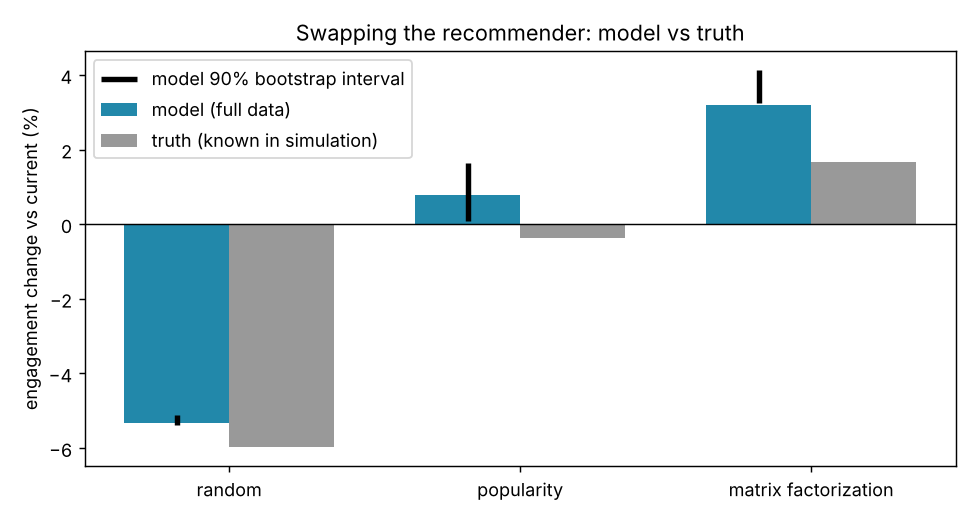

# Your dashboard says recommendations multiply viewing by 7.5×. The truth is 3.1×.

## I rebuilt Netflix's method in a simulation where I know the true answer. Then I tried to break it.

*Part 3 of Netflix Tech Blog, rebuilt. [Part 1: artwork personalization](https://medium.com/@faycal.zouine.usa/i-rebuilt-netflixs-artwork-personalization-system-on-movielens-here-s-what-actually-matters-d0540b7c43eb) · [Part 2: the billboard bandit](https://medium.com/@faycal.zouine.usa/i-rebuilt-netflixs-billboard-bandit-the-metric-picked-the-winner-686296a3b72f)*

Anyone who has worked on a recommender has been asked some version of this question by a leader: how much of our engagement comes from recommendations? I've spent eight years being asked the marketing version of it, usually about media spend, and the honest answer is always harder to get than the dashboard makes it look.

The dashboard answer is easy to build. You take every time a title was recommended and every time it wasn't, and you compare how often people watched it. When I did exactly that in the setup I describe below, recommended titles were watched 7.5 times more often. The real effect, which I know because I built the world it ran in, was 3.1 times. Most of the gap comes from something every analyst knows and most dashboards ignore: the recommender shows people what they were already likely to watch.

Netflix's research team recently published [a careful answer to this problem](https://netflixtechblog.com/measuring-the-impact-of-personalized-recommendations-4c26be3a4d96). Their approach is to model the choice itself. Every day, each member picks one title or decides to watch nothing, and the appeal of a title depends on the member's taste plus an extra push when the title is recommended that day. Because Netflix's recommender has some randomness in what it shows, they can separate "shown because you'd like it" from "watched because it was shown." They then checked the model against a real A/B test that nudged recommendations away from some titles, and it predicted where the lost viewing went with a correlation of 0.86.

I wanted to know how much of that holds up when you can see the right answer. You can't do that with real data, so I built a simulation instead.

## How I set it up

I started from about 890,000 real MovieLens ratings, which give me realistic tastes, popularity, genres and a viewing history for each member. On top of that I simulated 40 days of recommendations and viewing for 4,000 members, with every assumption written down in the notebook. One of those assumptions is the true effect of a recommendation, which I set at roughly 3× to match what Netflix reports. So the question isn't whether recommendations matter in my world. They do, by design. The question is whether Netflix's method can recover how much.

## What happened

It mostly does. The choice model estimated 3.4× against the true 3.1×, a lot closer than the dashboard's 7.5×. The validation step also behaved the way Netflix describes. When I simulated their nudge experiment on eight genres, the model's predictions matched the experiment with a correlation of 0.77, and matched the noise-free truth at 0.99. About a quarter of the viewing a genre lost went to members watching nothing that day, and the rest moved to other titles.

The remaining gap took me the longest to understand. My first version of the model came in 24% too high on the size of the push. My first suspicion was the estimator, so I tested it directly by giving it the true tastes, and it landed at 1.02 against a true 1.10. The estimator was fine. The problem was the part of the model that rebuilds each member's taste from their history. Whatever it misses, the recommender still knows, and that leftover knowledge leaks into the estimate. A better history encoder brought the error down to 11%. Training longer didn't help at all.

## Where it broke

Netflix doesn't report uncertainty in the post, so I added the standard fix: refit the model on ten resamples of members and report a 90% range for each alternative recommender. All three ranges missed the true value. The model ranked the alternatives correctly, with random worst and matrix factorization best, but it got the sign wrong for the popularity recommender, predicting +0.8% when the truth was −0.4%. A bootstrap only measures how much the estimate moves when you resample the data. It says nothing about whether the model itself is biased, so it produced tight ranges around slightly wrong answers.

The last test was the one I was most curious about. Netflix's method rests on the assumption that, once you account for what the model can see, the recommender isn't using any extra information about you. I broke that on purpose by giving the recommender one hidden signal about each member, the kind of thing a recent search might reveal. The model's estimate jumped from 3.4× to 7.0×, almost back to the dashboard number.

## What I take from it

None of this says Netflix's method is wrong. In my simulation it removed most of a very large bias, and the nudge experiment is a good way to check it against reality. What it does show is where the risk sits. The estimate is only as good as the model's picture of what the recommender knew, and a bootstrap range around it can look much more precise than it is. If I were presenting this kind of number to a leadership team, I would want a list of every signal the recommender uses, a nudge test to check the model, and a clear note that the range doesn't cover model error.

---

*Notebook and code: [github.com/ZFayFay/netflix-rec-impact-replication](https://github.com/ZFayFay/netflix-rec-impact-replication). The method belongs to the Netflix authors (Zielnicki, Aridor, Bibaut, Tran, Chou, Kallus). This is an independent rebuild of their [post](https://netflixtechblog.com/measuring-the-impact-of-personalized-recommendations-4c26be3a4d96) and [paper](https://arxiv.org/abs/2511.07280).*
